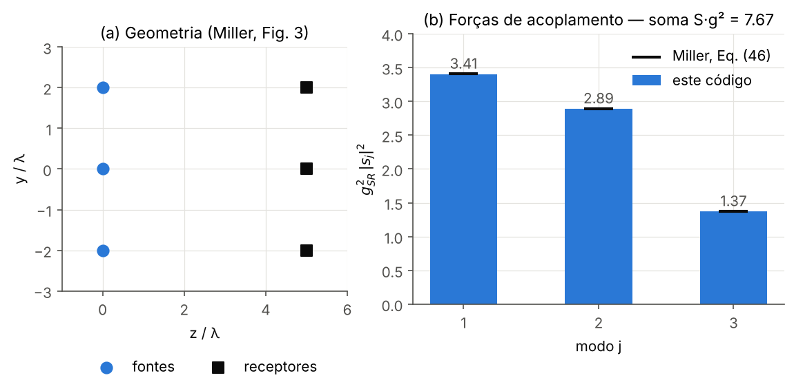
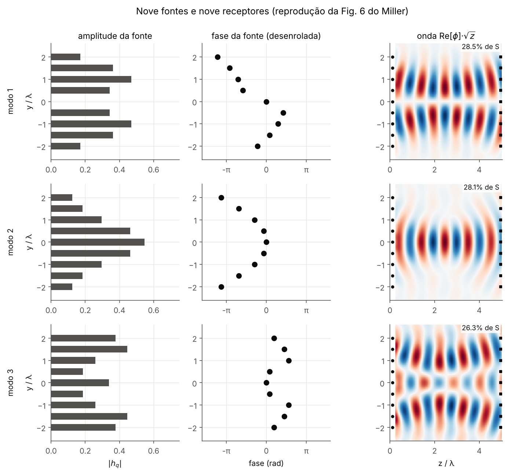
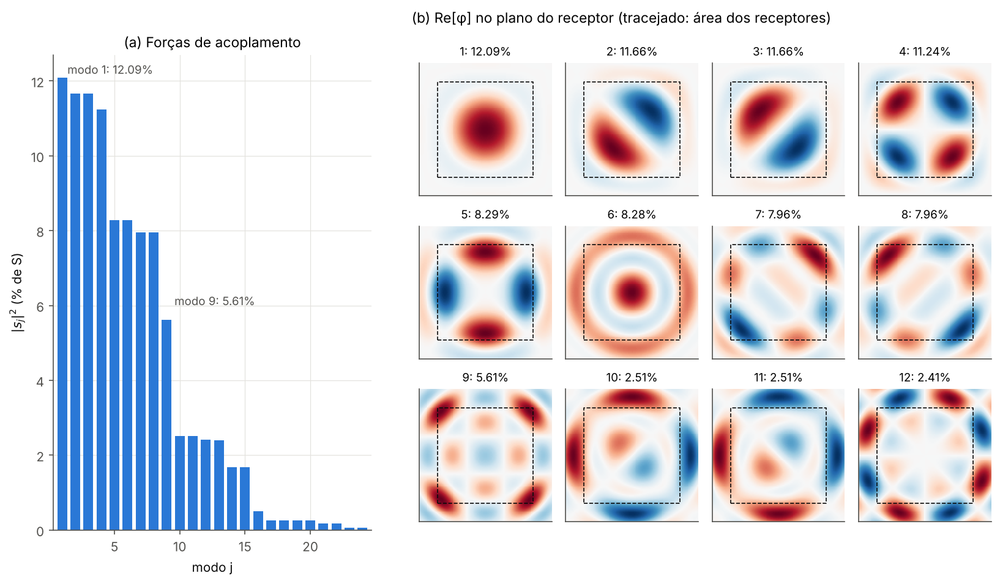
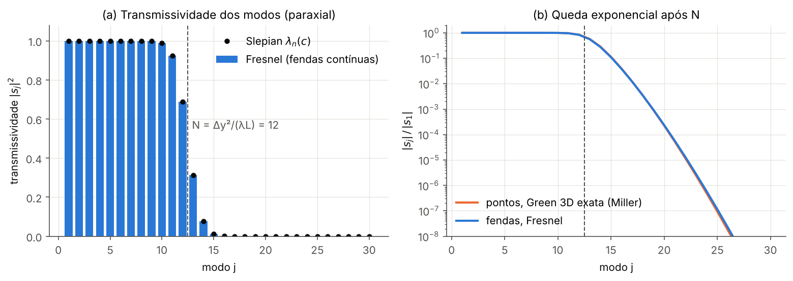
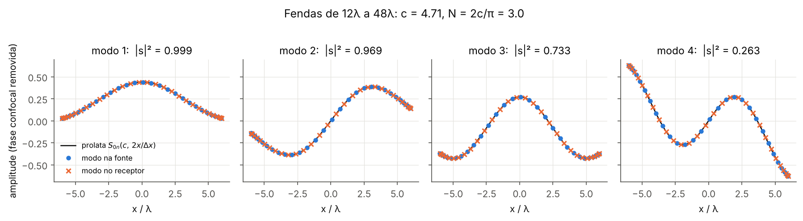
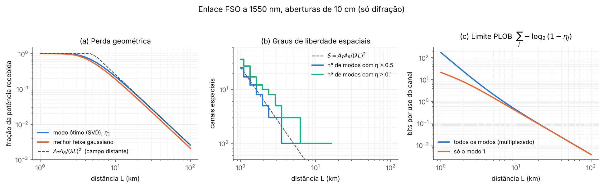

# Communication modes: SVD of the wave-coupling operator

Numerical study of **communication modes**: the optimal, orthogonal channels between a source region and a receiver region, obtained from the singular-value decomposition (SVD) of the Green's-function coupling operator. The code reproduces the main numerical examples of D. A. B. Miller's tutorial, connects the paraxial limit to Slepian's prolate spheroidal functions, and applies the result to a **diffraction-limited free-space QKD link**.

> Code comments and docstrings are in Portuguese (written alongside the course material); this README is in English.

## Physics in one page

A source distribution $|\psi_S\rangle$ produces a wave $|\phi_R\rangle = G_{SR}\,|\psi_S\rangle$ in the receiving region, where $G_{SR}$ is built from the scalar Green's function of the Helmholtz equation,

$$g_{ij} = -\frac{1}{4\pi}\,\frac{e^{ik|\mathbf r_{Ri}-\mathbf r_{Sj}|}}{|\mathbf r_{Ri}-\mathbf r_{Sj}|}.$$

$G_{SR}$ maps one space into another, so it has no physically meaningful eigenvectors. The Hermitian, positive operators $G^\dagger G$ (source → source) and $GG^\dagger$ (receiver → receiver) do. Their eigenvectors form the SVD:

$$G_{SR} = \sum_j s_j\,|\phi_{Rj}\rangle\langle\psi_{Sj}|, \qquad G|\psi_{Sj}\rangle = s_j|\phi_{Rj}\rangle .$$

- Each **communication mode** is a *pair* of functions: one in the source space and one in the receiver space.
- The pairs are orthogonal at both ends, so each pair is an independent channel with zero crosstalk.
- $|s_j|^2$ is the power coupling strength. $|\psi_{S1}\rangle$ is the normalized source that delivers the most power to the receiver, $|\psi_{S2}\rangle$ is the best source orthogonal to it, and so on.
- **Sum rule:** $\sum_j |s_j|^2 = \sum_{ij}|g_{ij}|^2$. This total is fixed by geometry and can be computed without solving the eigenproblem. Because it is finite, only a finite number of channels can be well coupled. This is the general form of the diffraction limit.

**Paraxial limit.** For two parallel apertures, the Fresnel kernel separates into quadratic ("confocal") phases times a truncated Fourier transform. $G^\dagger G$ then becomes Slepian's concentration kernel $\sin c(u-u')/\pi(u-u')$, with $c = k\,a_S a_R/L$. As a result:

- the transmissivities are the Slepian eigenvalues $\lambda_n(c)$: close to 1 up to $N$, then dropping abruptly;
- the modes are prolate spheroidal functions multiplied by confocal phase curvatures;
- the number of well-coupled channels is

$$N_{1\mathrm D} \approx \frac{\Delta x_S\,\Delta x_R}{\lambda L},\qquad N_{2\mathrm D}\approx\frac{A_S A_R}{(\lambda L)^2}.$$

With the kernel normalized so that $|E|^2$ is a power density, the sum rule equals *exactly* this number of degrees of freedom, and each $|s_j|^2 \le 1$ is a physical transmissivity.

## Results

| Check | This code | Reference |
|---|---|---|
| 3 × 3 point sources, $g^2_{SR}\lvert s_j\rvert^2$ | 3.41, 2.89, 1.37 (sum 7.67) | Miller Eqs. (46)–(47) |
| 9 × 9 point sources, all 9 coupling strengths | 20.73 … 6.5×10⁻⁸ (sum 72.65) | Miller Table 1 |
| 17 × 17 planar arrays, % of sum rule | 12.09 % (mode 1) … 5.61 % (mode 9) | Miller Fig. 8(c)* |
| Fresnel slits vs Slepian eigenvalues | agree to 10⁻¹⁰ | Slepian (1961) |
| Fresnel modes vs prolate functions $S_{0n}$ | overlap > 0.99999 | — |
| Far-field best truncated Gaussian / optimal mode | 81.5 %, $a/w = 1.12$ | Siegman, *Lasers* (81.45 %) |

\* The text of Miller's Section 5.2 gives a separation of 50λ. The values in Fig. 8(c), including the symmetry degeneracies of modes 2–3 and 7–8, are reproduced exactly with **100λ**, so that value is used here.

### 1. Three sources, three receivers (Miller §4)


### 2. Nine sources: more points do not create more channels (Miller Fig. 6)
Nine sources over the same 4λ give only about 3 strong channels: 97 % of the sum rule is in the first 4 modes. The SVD finds the phase curvature of each source by itself. Mode 1 is the two-lobed beam and mode 2 the single-lobed one, as in the paper.


### 3. Two-dimensional arrays (Miller Fig. 8)


### 4. The abrupt cutoff at N
Geometry of Miller's Fig. 9: a 48λ extent, L = 192λ, so $N = 48^2/192 = 12$. Three independent calculations are compared: point sources with the exact 3D Green's function, continuous slits with the Fresnel kernel, and the Slepian eigenvalues. Beyond N the singular values fall off exponentially.


### 5. Paraxial communication modes are prolate spheroidal functions
After removing the confocal phase curvature, the source and receiver modes are real, identical in shape, and equal to $S_{0n}(c, 2x/\Delta x)$.


### 6. Application: diffraction-limited free-space QKD link
The link uses λ = 1550 nm and two 10 cm circular apertures, with distances from 1 to 100 km. Only diffraction is modeled: no turbulence, absorption or pointing error. Each communication mode is an independent pure-loss channel with transmissivity $\eta_j = |s_j|^2$.

- **(a) Geometric loss.**
  - $\eta_1$ is the *maximum* power any field launched from the transmit aperture can deliver into the receive aperture.
  - At 10 km: $\eta_1 = 0.226$, while the best Gaussian beam (width and focus optimized) reaches $0.189$.
  - In the far field, $\eta_1 \to A_TA_R/(\lambda L)^2$ and the Gaussian tends to Siegman's 81.5 % of it.
- **(b) Spatial channels.** The number of channels with $\eta_j > 0.5$ follows $A_TA_R/(\lambda L)^2$: about 25 channels at 1 km, 1 channel near 4 km, none beyond 6 km.
- **(c) PLOB bound.** The repeaterless secret-key capacity of a pure-loss channel is $-\log_2(1-\eta)$ per use [Pirandola et al. 2017]. The orthogonal modes are independent channels, so with spatial multiplexing the bound becomes $\sum_j -\log_2(1-\eta_j)$. That sum exceeds the single-mode bound in the near field, and both coincide in the far field, where only one mode survives.



This complements [bb84-decoy-fiber](https://github.com/carolelias/bb84-decoy-fiber): there the channel is a lossy fiber with a single spatial mode; here the spatial structure of a free-space channel is derived from first principles.

## Repository layout

```
comm_modes/
  green.py      exact 3D scalar Green's function; Fresnel kernels (1D slits, 2D apertures) with quadrature weights
  geometry.py   point lines/planes; Gauss–Legendre slits; polar quadrature for circular apertures
  modes.py      SVD → communication modes, sum rule, phase fixing
  paraxial.py   Slepian eigenvalues (Nyström), prolate functions, heuristic numbers, confocal phase
  fso.py        free-space link: mode transmissivities, optimized Gaussian beam, PLOB bounds
scripts/        fig01 … fig06 and run_all.py
tests/          23 tests: Miller's numbers, SVD identities, paraxial limit, FSO physics
figures/        generated PNGs
```

## Numerical notes

- Continuous apertures are discretized with **quadrature weights**: $M_{ij} = \sqrt{w_{Ri}}\,h(x_{Ri},x_{Sj})\sqrt{w_{Sj}}$. The singular values of the matrix then converge to those of the integral operator, and the Cartesian inner product approximates $\int|\psi|^2$.
- **Circular apertures use polar quadrature:** Gauss–Legendre in $r$ and the trapezoidal rule in $\theta$, which is spectrally accurate for periodic functions.
  - The number of points scales with $c = k a_T a_R/L$.
  - A staircase Cartesian grid was tried first. It gave ~1 % errors and even $|s_1|^2 > 1$, which violates power conservation.
  - The polar grid converges to $10^{-8}$ and reproduces the sum rule to machine precision.
- The SVD is computed directly with LAPACK (`numpy.linalg.svd`) rather than by diagonalizing $G^\dagger G$, which would square the condition number.

## Usage

```bash
pip install -r requirements.txt
python scripts/run_all.py     # regenerates figures/ (~30 s)
pytest                        # runs the test suite
```

## Limitations

- **Scalar waves only.** The electromagnetic (vector) case would roughly double the channel count through polarization; Miller treats it with the M-gauge in §8.
- **Monochromatic.**
- **FSO model is diffraction only.** Atmospheric turbulence would couple the modes and fade their transmissivities, and the PLOB curves are ideal upper bounds. No finite-key or detector effects are included.

## References

1. D. A. B. Miller, "Waves, modes, communications, and optics: a tutorial," *Adv. Opt. Photon.* **11**, 679 (2019). doi:10.1364/AOP.11.000679
2. D. A. B. Miller, "Communicating with waves between volumes: evaluating orthogonal spatial channels and limits on coupling strengths," *Appl. Opt.* **39**, 1681 (2000).
3. D. Slepian and H. O. Pollak, "Prolate spheroidal wave functions, Fourier analysis and uncertainty — I," *Bell Syst. Tech. J.* **40**, 43 (1961).
4. S. Pirandola, R. Laurenza, C. Ottaviani, L. Banchi, "Fundamental limits of repeaterless quantum communications," *Nat. Commun.* **8**, 15043 (2017).
5. A. E. Siegman, *Lasers* (University Science Books, 1986) — optimum truncated Gaussian aperture.

Started from a course presentation on communication modes (Localized Waves, EESC-USP, 2024).
